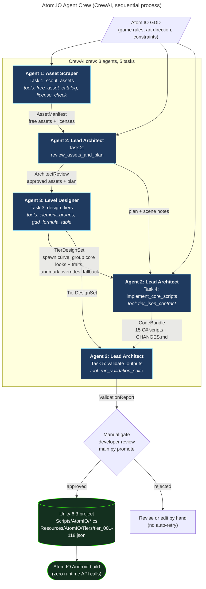

# Atom.IO Agent Crew

**Game: Atom.IO.** This is my capstone game: a single-player Android .io-style arcade game based on the Bohr atomic model. You start as Hydrogen and evolve up the periodic table to Oganesson (element 118). It's built in Unity 6.3 LTS.

This repo is a **CrewAI** system of **3 agents** (Asset Scraper, Lead Architect, Level Designer). They work together to produce game-ready content for Atom.IO, which can be dropped straight into the Unity project.

## What the crew produces

Each run writes a staging folder, `output/run_<timestamp>/`, laid out like a Unity project:

| Output | Made by | Used in the game for |
|---|---|---|
| `01_asset_manifest.json` | Asset Scraper | Free, license-checked assets (particles, touch controls, UI, fonts, SFX, URP bloom) |
| `02_architect_review.json` | Lead Architect | Approved and rejected assets, implementation plan, prefab and scene setup |
| `03_tier_design_set.json` | Level Designer | Spawn curve, core look and trait per element group, landmark overrides, fallback |
| `unity/Assets/Resources/AtomIO/Tiers/tier_001…118.json` + `tier_fallback.json` + `index.json` | Level Designer + expander | Loaded by `TierConfigLoader` when the player enters the arena |
| `unity/Assets/Scripts/AtomIO/**.cs` (15 files) | Lead Architect | Core gameplay: atom, Bohr electron shells, enemies, spawner, energy, lobby evolution with failure chance, tutorial, HUD, touch sticks |
| `CHANGES.md` | Lead Architect | Change log required by the GDD |
| `05_validation_report.json`, `GATE.json`, `usage.json` | Validation suite + Lead Architect | Gate status and token/cost use |

Nothing touches the real Unity project until you run `promote`. That's the manual gate from GDD 2.5.

## The agents (GDD section 2)

| # | Agent | Model (default) | Tools | Contract (Pydantic output) |
|---|---|---|---|---|
| 1 | **Asset Scraper** | Claude Haiku 4.5 | `free_asset_catalog`, `license_check`, optional `SerperDevTool` | `AssetManifest`: free assets only, with license, URL, local path and Unity note |
| 2 | **Lead Architect** | Claude Sonnet 4.5 | `gdd_formula_table`, `tier_json_contract`, `run_validation_suite` | `ArchitectReview` → `CodeBundle` (compilable C# + CHANGES.md) → `ValidationReport` |
| 3 | **Level Designer** | Claude Sonnet 4.5 | `element_groups`, `gdd_formula_table` | `TierDesignSet`: spawn curve, group designs, overrides, required fallback |

The crew runs 5 tasks in a sequential process:

1. `scout_assets` (Scraper)
2. `review_assets_and_plan` (Architect)
3. `design_tiers` (Level Designer, uses the approved assets only)
4. `implement_core_scripts` (Architect, uses the plan and calls `tier_json_contract`, which builds a tier file from *this run's* Level Designer output)
5. `validate_outputs` (Architect, runs the deterministic validation suite)

Every hand-off between agents is a Pydantic model. CrewAI parses each output and passes it to the next task as context.

## Architecture diagram

The diagram below shows each agent's role, connections and data flow. The source is `crew_diagram.mmd`, also rendered as `crew_diagram.png`.



## Why every agent is required

Each agent produces something the next one needs. The validation suite checks every hand-off, so removing any agent blocks the run at the gate. You can try it yourself:

```bash
python main.py run --mock --without asset_scraper
python main.py run --mock --without lead_architect
python main.py run --mock --without level_designer
```

| Agent removed | What breaks | Result |
|---|---|---|
| **Asset Scraper** | No `AssetManifest`, so the Architect's approvals have no source. Every asset the Level Designer uses for core textures and particles becomes untrusted. | Gate **BLOCKED** (27 errors) |
| **Lead Architect** | No asset approvals (the Level Designer's asset references are all rejected), no C# to load the tier files, no plan, no validation report. | Gate **BLOCKED** (19 errors) |
| **Level Designer** | No `TierDesignSet`, so no 118 tier files. `tier_json_contract` returns an error, so the Architect's C# has no data contract to match. | Gate **BLOCKED** (2 errors) |
| none | | Gate **READY FOR REVIEW** (0 errors) |

### How the crew stays faithful to the GDD
- **The agents never do the GDD math.** `gdd_rules.py` holds every fixed rule:
  - HP = 10·Z
  - electron slots = Z
  - evolution cost = 50 + 3Z
  - failure chance = (−1 + 1.04015^(Z−1))%, minus 0.5% per failure
  - damage values of 10/20

  The Level Designer only picks style and tuning values. `tiers.py` multiplies those out to all 118 tiers.
- **Every tier is covered.** Any group the designer skips gets the fallback block. In the sample run, elements 109–118 use the fallback, except Og, which has its own landmark design.
- **Validation suite** (`validators.py`), run by the Architect's tool and run again independently before the gate:
  - free and commercial-safe licenses only
  - spawn values within range
  - valid `#RRGGBB` colours
  - every agent's output must be present, and the Architect must approve at least one sourced asset
  - assets referenced by the designer must be approved by the Architect, and it must use at least one of them
  - GDD numbers re-checked on all 118 files
  - C# paths, file name must match the type name, no networking or external packages (GDD 3.1.2)
  - **JSON-to-C# contract:** every tier JSON key must have a public C# field, otherwise `JsonUtility` would silently drop it
  - an **`mcs` compile check** against Unity API stubs, when Mono is installed
- **Token budget** (`budget.py`, from GDD 3.2):
  - per-agent caps: Scraper 45k, Architect 480k, Level Designer 885k
  - 1.41M tokens total, with a $10 ceiling
  - checked after every task; a run that goes over stops cleanly and keeps its partial output

## Setup

```bash
python -m venv .venv && source .venv/bin/activate      # Python 3.10–3.13
pip install -r requirements.txt
cp .env.example .env                                    # add ANTHROPIC_API_KEY for live runs
# optional: sudo apt install mono-mcs   (or brew install mono) to turn on the C# compile check
```

## Run

```bash
python main.py run --mock          # offline demo, no API key needed, full CrewAI pipeline
python main.py run                 # live run with Claude
python main.py run --verbose       # show each agent's reasoning and tool calls
python main.py run --mock --without level_designer   # drop one agent to show the pipeline breaks
python main.py validate            # re-run the validation suite on output/latest
python main.py promote --unity-project ~/UnityProjects/AtomIO   # manual gate: copy into Unity
```

> **About mock mode:** it is a no-key demo that proves the CrewAI pipeline runs end to end. The agent *answers* are canned, so the C# and the designs are the same every time, but the orchestration, tool calls, hand-offs and validation are all real. A live run (`python main.py run`) is where Claude actually writes the content.

**Mock mode** replaces Claude with `MockLLM`, a real CrewAI `BaseLLM` that returns canned answers. Everything else runs for real:
- agents, tasks, context passing and Pydantic parsing
- tool calls: the Scraper calls the catalog and the license checker, the Level Designer reads the element groups, and the Architect runs the validation suite and reports its real result
- callbacks, budget checks, tier expansion and the compile check

Mock mode is how I check that the crew runs without crashing. The C# it writes is the reference implementation in `atomio_crew/mock_data/csharp/`, and it compiles cleanly against the stubs.

Sample console output (mock):
```
== Atom.IO crew (mock) : Asset Scraper -> Lead Architect -> Level Designer -> Lead Architect ==
Crew completed.
Output: output/run_20261101-231731
Validation: PASSED (0 errors, 1 warnings)
  warning groups not designed, will use fallback: ['unknown_properties']
Tokens: 75,268 / 1,410,000 cap   cost ~$0.430 / $10 ceiling
```
(Mock token counts are estimated as about 4 characters per token, so they roughly match a live run.)

## Using the output in Unity
1. Run `promote`. It copies `Assets/Scripts/AtomIO/` and `Assets/Resources/AtomIO/Tiers/` into the project and appends to `CHANGES.md`.
2. Follow `prefab_scene_notes` in `02_architect_review.json`:
   - Lobby and Arena scenes
   - Player, Electron, Enemy and EnergyOrb prefabs
   - Physics2D layers
   - a Canvas with two `TouchStick`s
3. Download the approved Kenney packs (CC0) into the planned `local_path` folders.

## Project layout
```
main.py                     CLI (run / validate / promote)
crew_diagram.mmd / .png     Mermaid diagram
data/gdd_atomio.md          GDD summary given to the agents
atomio_crew/
  config/agents.yaml        agent roles, goals, backstories
  config/tasks.yaml         5 task prompts (the GDD 2.3 prompt contracts)
  crew.py                   builds LLMs, agents, tasks and the crew
  schemas.py                Pydantic contracts between agents
  gdd_rules.py              GDD formulas + periodic table + element groups
  tiers.py                  TierDesignSet -> 118 tier JSON files + fallback
  tools.py                  agent tools + shared run state
  validators.py             validation suite (+ mcs compile check)
  budget.py                 token caps and $ ceiling
  postprocess.py            staging output, CHANGES.md, promote gate
  mock_llm.py, mock_data/   offline mode + reference C# scripts and tier design
  compile_check/UnityStubs.cs   Unity API stubs for the compile check
sample_output/              output from a mock run, for graders
```

## Notes and limits
- **Scope change from the GDD's token table:** the GDD estimated about 354 Level Designer calls, roughly 3 per element. The crew designs per element group plus landmark overrides and expands the rest in code, which uses far fewer tokens for the same 118 files.
- The asset catalog is a curated, offline list of real free packs (Kenney CC0, Unity first-party, one free Asset Store pack). Setting `SERPER_API_KEY` also gives the Scraper live web search. Check each URL and license before you download.
- The `mcs` check compiles against stubs, not the real Unity engine. It catches C# errors and broken contracts, but the final compile still happens in Unity at the manual gate.
- Model names live in `.env`, so you can switch models without changing code.
