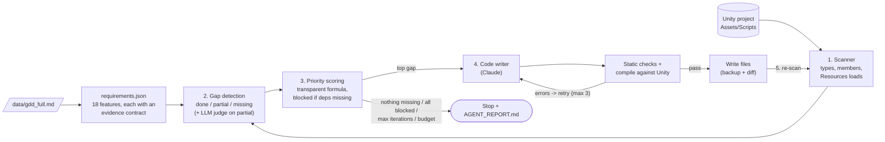

# Assignment 5: Atom.IO Goal-Oriented Coding Agent

**Game: Atom.IO** (Unity 6.3, Android). The agent reads the Atom.IO GDD, scans the Unity project's C# scripts, finds the GDD features that are missing, decides which one to build next, writes the code, checks it, and re-scans. It repeats until every requirement is met.

```bash
python main.py build --dry-run        # scan + gaps + priority scores, writes nothing
python main.py build                  # live: Claude writes the missing features into the Unity project
python main.py build --mock           # offline demo (no API key), works on a sandbox copy
python main.py build --only R16       # build one specific requirement
python main.py build --extract-requirements   # re-derive the requirement list from the GDD (for review)
```
The Unity project path comes from `ATOMIO_UNITY_PROJECT` in `.env`, or from `--unity-project`.

## How it decides what to build



1. **Requirements from the GDD** (`data/requirements.json`). Each requirement has:
   - its GDD section and acceptance criteria
   - an **evidence contract**: the types, members and Resources paths that prove it exists
   - its dependencies, the data files it needs, the existing scripts it may hook into, an effort estimate and whether players see it

   `--extract-requirements` asks Claude to re-derive the list from the GDD and writes a *proposed* file for human review. The list is never replaced silently.
2. **Scanner** (`coder/scanner.py`). Plain code with no LLM. It indexes every script in `Assets/Scripts`: types, methods, properties, events, `Resources.Load` paths, and the data files in `Resources`.
3. **Gap detection** (`coder/gaps.py`). Each requirement is checked against the index: all evidence found = **done**, some = **partial**, none = **missing**. In live runs, an LLM judge reads the code for *partial* gaps and confirms the verdict.
4. **Priority scoring** (`coder/priority.py`):
   ```
   score = 3 x GDD importance (core 3, ui 2, retention 2, polish 1)
         + 2 x unblocks      (open gaps that depend on it)
         + 2 x player impact (visible in a normal run)
         + 1 x assets ready  (its data files already exist)
         - 1 x effort        (1..3)
   blocked (not eligible) while any dependency is not done
   ties: importance, then unblocks, then lower effort, then GDD order
   ```
5. **Code-writing step** (`coder/writer.py`). Claude gets:
   - the requirement and its evidence contract
   - the GDD sections it comes from
   - a map of the codebase
   - the full text of the scripts it may hook into
   - a sample of the data files it should load

   Claude returns complete C# files.

   **House rules:**
   - Features set themselves up at runtime, so no scene or prefab wiring is needed.
   - Existing files are changed only with additive hooks.
   - The legacy Input API is never used.
   - There is no networking.
6. **Checks before anything is written** (`coder/compiler.py`):
   - path, file name equals type name, namespace, banned APIs, and only allowed files modified
   - **a compile of the whole project with the change**, using the best compiler available:
     1. **Unity's own Roslyn compiler** with the project's real references
     2. Mono `mcs` with the real Unity DLLs
     3. Mono `mcs` with stubs

     A compiler is only trusted if the unchanged project compiles with it. Errors go back to Claude, up to 3 attempts; after that the feature is marked failed and the agent moves on.
7. **Iteration loop** (`coder/agent.py`). After each write, the agent re-scans. The new code must satisfy its evidence contract, or it's marked failed, which prevents an endless loop. A newly finished feature can unblock others. **It stops when all requirements are met**, everything left is blocked or failed, `--max-iterations` is reached, or the budget cap is hit.

Each run saves its work in `output/agent_runs/run_<time>/`:
- every scan's gap table and score breakdown
- each attempt's check results
- a `.diff` per iteration
- backups of modified files

The latest report is copied to `agent_report/AGENT_REPORT.md`.

## Current state of Atom.IO (first scan)

14 of 18 GDD requirements are already implemented, by the Assignment 3 crew. The 4 gaps, and the order the agent builds them in:

| Req | Feature | GDD | Score | Why |
|---|---|---|---|---|
| R16 | Element-group abilities | 1.4.4 / 1.4.5 | 3x2 + 2x1 + 2x1 + 1x1 - 1x3 = **8** | Retention feature; `group_abilities.json` (Assignment 4) already exists; R18 depends on it. Wins the tie with R17 because it unblocks a feature. |
| R17 | Element card in the lobby | 1.3.2 / 1.4.4 | 3x2 + 0 + 2x1 + 1x1 - 1x1 = **8** | `element_cards.json` exists; small effort |
| R18 | Ability indicator in the HUD | 1.4.5 | 3x2 + 0 + 2x1 + 0 - 1x1 = **7** | **Blocked** by R16 on the first scan, then becomes eligible after the re-scan |
| R15 | Arena settings menu | 1.4.2 | 3x2 + 0 + 2x1 + 0 - 1x2 = **6** | GDD top-right "settings"; no data, more UI work |

## Assignment README (to finish after the live run)
1. **What feature the agent built:** see `agent_report/AGENT_REPORT.md` and the playtest.
2. **Why the agent picked it:** the priority table above, plus the report's per-scan scores.
3. **Manual changes before accepting the code:** fill in from the playtest and `git diff` in the Unity project.

> **Mock mode** (`--mock`) runs the whole loop offline on a sandbox copy of the scripts. It uses reference implementations, with one deliberate bug in R17's first attempt so the compile-and-retry path is visible. Live runs use Claude.
