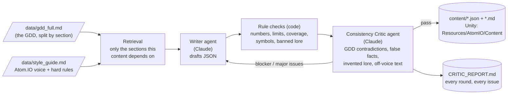

# Assignment 4: Atom.IO Dynamic Content Pipeline

**Game: Atom.IO**, my capstone. It's an Android arcade .io game based on the Bohr atomic model: you start as Hydrogen and evolve up the periodic table to Oganesson (element 118).

The pipeline reads the Atom.IO GDD before writing anything. A **Writer agent** drafts content, and a **Critic agent** checks it against the GDD. The draft goes back for revision until the critic passes it (at most 3 rounds).

```bash
python main.py generate --mock     # offline demo, no API key
python main.py generate            # live run with Claude (needs ANTHROPIC_API_KEY in .env)
python main.py generate --only ui_text --max-rounds 3
```

## How it works



1. **Grounded in the GDD.** `data/gdd_full.md` is my GDD transcribed and split by section. Each content type pulls only the sections it depends on (for example, the tutorial text uses 1.3.1–1.4.3) plus `data/style_guide.md`. The element cards also get the real periodic table, and the abilities get the stat traits the Assignment 3 crew already designed, so the two don't overlap.
2. **Writer agent** returns JSON in a fixed schema (Pydantic), so the output can be loaded straight into Unity.
3. **Critic** has two layers:
   - **Rule checks in code**, which the LLM can't talk its way around:
     - every number has to be a GDD value (10 HP per proton, cost 50 + 3Z, 0.5% pity, 10/20 damage, 118)
     - UI character limits
     - all 118 elements and all 11 groups covered
     - correct element symbols
     - balance ranges for abilities
     - required `{placeholders}`
     - banned invented-lore and rule-breaking words
   - **LLM Consistency Critic**, a separate agent with its own prompt. It catches what code can't: contradictions with GDD mechanics, false science facts, invented lore and text that doesn't sound like Atom.IO. It returns structured issues with a severity, the GDD section, and a fix.
4. **Consistency loop.** If any blocker or major issue remains, the Writer gets its previous draft plus every issue and revises. This repeats until the critic passes the draft or 3 rounds are used up; content still failing after round 3 is saved as `needs_review`, never silently approved. A malformed reply is caught and sent back for revision, so the pipeline doesn't crash.
5. **Everything is logged.** Each round's draft and review are saved in `output/content_runs/`. `content/CRITIC_REPORT.md` lists every issue the critic caught.

## The three outputs (all needed by the game)

| Output | File | Where it's used in Atom.IO |
|---|---|---|
| **Element cards** for all 118 elements (title + one-line flavor text based on a real fact) | `content/element_cards.json` / `.md` | Lobby evolve screen, shown on every evolution (GDD 1.3.2, 1.4.4) |
| **Tutorial, HUD and lobby text**: run-1 and run-2 tutorial hints, forced He evolution prompt, evolve success/fail, run over, win at Og, 8 loading tips | `content/ui_text.json` / `.md` | The GDD 1.4.3 tutorial and every lobby/arena message. It plugs into `ArenaHud` and `LobbyController` from Assignment 3. |
| **Element-group abilities**: one per group, each based on real chemistry, with trigger, effect, value and cooldown | `content/group_abilities.json` / `.md` | The GDD 1.4.5 bonus feature (third retention mechanism) |

Unity-ready copies are written to `content/unity/Assets/Resources/AtomIO/Content/`. They use the same JsonUtility-friendly format as the tier files.

## Does it sound like Atom.IO?

Mostly, yes, because the GDD and style guide set the voice:
- **The player is the atom.** Lines talk about protons, shells, orbiting and thrown electrons, and fusing. There are no heroes, ships or story.
- **The "lore" is the real periodic table.** The GDD has no story, so the critic treats invented lore as a bug. Flavor comes from real chemistry instead: helium lifting balloons, gallium melting in your hand, Bohrium honoring the Bohr model you're playing in, Mendelevium "who built the periodic table you're climbing".
- **Arcade-length lines** that fit a landscape phone UI, enforced by code.
- **Mechanics-literate text.** Tutorial lines and tips teach the real rules: 10 HP per proton, cost 50 + 3 per proton, last electron always stays in orbit.

What's weaker: across 118 cards, some lines are more trivia than personality. The abilities' numbers are a starting point for playtesting; they're not tuned.

## What did the critic catch?

From the run in `content/CRITIC_REPORT.md` (every round has its own section there):

| Content | Caught by code | Caught by the Critic agent |
|---|---|---|
| Element cards | Gold given symbol **Ag** instead of Au; element **113 missing**; tin's flavor at **124 chars** (limit 110); invented lore ("Proton **King**" guarding a "**realm**") | **False fact:** "Helium, the lightest element". Hydrogen is lighter, and it's the player's starting element. |
| UI text | A loading tip claiming **25 HP** per proton (GDD: 10); a fail message missing `{next_fail_pct}` | **Contradicted GDD 1.3.3:** "evolving always costs 50 energy" (it's 50 + 3Z). **Contradicted the 1.4.2 balance note:** "throw your last one". The last electron can never be thrown. |
| Group abilities | Alkali damage multiplier **2.0** (balance cap 1.5); noble gas ability made you "**invincible**"; the **unknown-properties** group had no ability | **Wrong chemistry:** halogens described as having "a full outer shell". That's the noble gases; halogens are one electron short. |

All three passed in round 2 after revision.

> **Mock vs live:** `--mock` runs the whole pipeline offline. Its first drafts have these mistakes planted on purpose, so the loop can be shown without an API key. In a live run Claude writes everything, and the report reflects whatever the critic actually found. The live run's report is the one to read.

## Files
```
main.py generate                    CLI entry point
data/gdd_full.md                    GDD source (split by section for retrieval)
data/style_guide.md                 Atom.IO voice + hard rules the critic enforces
atomio_crew/content/context.py      GDD loading + section retrieval
atomio_crew/content/specs.py        the 3 content specs: schema, task, rule checks, preview
atomio_crew/content/pipeline.py     Writer/Critic prompts, revision loop, logging, outputs
atomio_crew/content/mock.py         offline mock Writer/Critic
content/                            generated outputs + CRITIC_REPORT.md + critic_log.json
```
