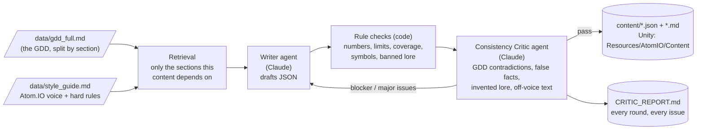

# Assignment 4: Atom.IO Dynamic Content Pipeline

**Game: Atom.IO**, my capstone. It's an Android arcade .io game based on the Bohr atomic model: you start as Hydrogen and evolve up the periodic table to Oganesson (element 118).

The pipeline reads the Atom.IO GDD before writing anything. A **Writer agent** drafts content, and a **Critic agent** checks it against the GDD. The draft goes back for revision until the critic passes it (at most 3 rounds).

```bash
python main.py generate --mock     # offline demo, no API key
python main.py generate            # live run with Claude (needs ANTHROPIC_API_KEY in .env)
python main.py generate --only ui_text --max-rounds 3
```

## How it works



1. **Grounded in the GDD.** `data/gdd_full.md` is my GDD transcribed and split by section. Each content type pulls only the sections it depends on (for example, the tutorial text uses 1.3.1–1.4.3) plus `data/style_guide.md`. The element cards also get the real periodic table, and the abilities get the stat traits the Assignment 3 crew already designed, so the two don't overlap.
2. **Writer agent** returns JSON in a fixed schema (Pydantic), so the output can be loaded straight into Unity.
3. **Critic** has two layers:
   - **Rule checks in code**, which the LLM can't talk its way around:
     - every number has to be a GDD value (10 HP per proton, cost 50 + 3Z, 0.5% pity, 10/20 damage, 118)
     - UI character limits
     - all 118 elements and all 11 groups covered
     - correct element symbols
     - balance ranges for abilities
     - required `{placeholders}`
     - banned invented-lore and rule-breaking words
   - **LLM Consistency Critic**, a separate agent with its own prompt. It catches what code can't: contradictions with GDD mechanics, false science facts, invented lore and text that doesn't sound like Atom.IO. It returns structured issues with a severity, the GDD section, and a fix.
4. **Consistency loop.** If any blocker or major issue remains, the Writer gets its previous draft plus every issue and revises. This repeats until the critic passes the draft or 3 rounds are used up; content still failing after round 3 is saved as `needs_review`, never silently approved. A malformed reply is caught and sent back for revision, so the pipeline doesn't crash.
5. **Everything is logged.** Each round's draft and review are saved in `output/content_runs/`. `content/CRITIC_REPORT.md` lists every issue the critic caught.

## The three outputs (all needed by the game)

| Output | File | Where it's used in Atom.IO |
|---|---|---|
| **Element cards** for all 118 elements (title + one-line flavor text based on a real fact) | `content/element_cards.json` / `.md` | Lobby evolve screen, shown on every evolution (GDD 1.3.2, 1.4.4) |
| **Tutorial, HUD and lobby text**: run-1 and run-2 tutorial hints, forced He evolution prompt, evolve success/fail, run over, win at Og, 8 loading tips | `content/ui_text.json` / `.md` | The GDD 1.4.3 tutorial and every lobby/arena message. It plugs into `ArenaHud` and `LobbyController` from Assignment 3. |
| **Element-group abilities**: one per group, each based on real chemistry, with trigger, effect, value and cooldown | `content/group_abilities.json` / `.md` | The GDD 1.4.5 bonus feature (third retention mechanism) |

Unity-ready copies are written to `content/unity/Assets/Resources/AtomIO/Content/`. They use the same JsonUtility-friendly format as the tier files.

## Does it sound like Atom.IO?

Mostly, yes. The critic gave all three outputs **4/5 for voice** in the live run. Examples straight from `content/`:
- **The player is the atom, and the table is the progression.**
  - Bohrium: *"Niels Bohr's atom model inspired this very game. This element honors him."*
  - Mendelevium: *"Mendeleev built the periodic table. You're climbing it."*
  - Oganesson: *"…The heaviest element on the table. Reach it and you win."*
- **The "lore" is real chemistry.** The GDD has no story, so the critic treats invented lore as a bug:
  - Helium: *"Named for helios, Greek for sun. It was spotted in sunlight before anyone found it on Earth."*
  - Caesium: *"…run the atomic clocks that define the second."*
- **Text that teaches the real rules.** The loading tips repeat GDD numbers exactly:
  - *"Evolving costs 50 + 3 x your atomic number in energy."*
  - *"You can only throw an electron when you hold more than one."*
- **Abilities with a chemistry hook:**
  - Halogens: *"A kill sprays disinfectant and heals 10 HP."*
  - Noble gases: *"Your glow draws loose electrons and energy orbs in from 20% farther away."*

**Where it's weaker** (the critic flagged this too): the late-game cards (Z=104–118) lean on "Named for…" and read like a list of dedications, just when the player is close to winning. A few ability descriptions are vague about durations ("for a moment"). These are minor issues, so they didn't block approval. They're the first things I'd polish by hand.

## What did the critic catch? (live run)

The full log is in `content/CRITIC_REPORT.md`. Totals: **28 issues across 8 rounds, 8 of them blocking.** All three outputs ended **approved** (element cards and abilities in round 3, UI text in round 2). The run took 14 Claude calls, about 172k tokens and **~$1.42**.

| Content | What the critic caught | What changed |
|---|---|---|
| **Element cards** | **Round 1:** the Writer's 118-card JSON was malformed, so the rule checker rejected it and sent it back. **Round 2:** the code checks flagged "king" on silver's card as invented lore. The Critic agent flagged a **doubtful fact**: "caesium keeps the world's best clocks" isn't true (ytterbium and strontium optical clocks are better), and it **contradicted the Yb card**. It also found misleading wording on Ytterby (Y) and the iridium impact layer (Ir). | Caesium now reads *"run the atomic clocks that define the second"*. Silver became *"Top Conductor"*. The Y and Ir wording was fixed. Approved in round 3 with only minor polish notes. |
| **Tutorial / HUD text** | The Critic agent caught a **made-up mechanic**: a tip said *"More protons, bigger orbit"*, but the GDD never says the orbit grows. It also flagged *"Break line of sight"* (the GDD has sight *range*, not walls), and *"Orbit lost!"* as a run-over message, which contradicts the always-one-electron rule. | Rewritten to *"Evolve for more slots and +10 HP"*, *"Outrun them and they give up"* and *"Core down!"*. Approved in round 2. |
| **Group abilities** | **Round 1:** malformed JSON, caught and sent back. **Round 2:** the Critic agent caught a **description contradicting its own data**: *"Each kill heals you 10 HP"* on an ability with a 12 s cooldown. It also flagged plural wording on cooldown abilities, a weak link between the noble gas glow and its effect, and two pairs of near-duplicate effects. | It became *"A kill sprays disinfectant and heals 10 HP. Ready again after 12 seconds."* The glow ability was retitled *Discharge Glow* with a clear link. Approved in round 3. |

**The critic also got one wrong.** The code check rejected the number **0** in two UI lines (for example "0% failure chance" for the first evolution). The GDD actually says the failure chance *starts at 0%*, so this was a false positive in my rule list. The Writer reworded the lines anyway, and I've since added 0 to the allowed GDD numbers.

**Takeaway:** the code checks caught structure problems: broken JSON, banned words, numbers. The LLM critic caught the subtle problems code can't see: a fact that's out of date, a mechanic the GDD never defines, and text that contradicts its own cooldown. Each round's feedback got fixed in the next draft.

> `--mock` runs the same loop offline. Its first drafts have mistakes planted on purpose (wrong symbol, missing element, "invincible", a 2.0 multiplier…) so the loop can be demonstrated without an API key.

## Files
```
main.py generate                    CLI entry point
data/gdd_full.md                    GDD source (split by section for retrieval)
data/style_guide.md                 Atom.IO voice + hard rules the critic enforces
atomio_crew/content/context.py      GDD loading + section retrieval
atomio_crew/content/specs.py        the 3 content specs: schema, task, rule checks, preview
atomio_crew/content/pipeline.py     Writer/Critic prompts, revision loop, logging, outputs
atomio_crew/content/mock.py         offline mock Writer/Critic
content/                            generated outputs + CRITIC_REPORT.md + critic_log.json
```
